<!-- ───────────────────────────────────────────────────────────────
  cyberRuptor · FIELD MANUAL
  Visuals live in ./assets and are generated by assets/build.py
──────────────────────────────────────────────────────────────── -->

<picture>
  <source media="(prefers-color-scheme: dark)" srcset="./assets/shiva-dark.svg">
  
</picture>

  

<picture>
  <source media="(prefers-color-scheme: dark)" srcset="./assets/hero-dark.svg">
  
</picture>

  

<picture>
  <source media="(prefers-color-scheme: dark)" srcset="./assets/h-now-dark.svg">
  
</picture>

`building ` &nbsp; self-healing CI/CD that files its own Jira tickets — and fixes what it can before a human sees them 
`securing ` &nbsp; Kubernetes at **Airtel Digital**: admission policy, runtime detection, least-privilege by default 
`exploring` &nbsp; Gateway API, MCP servers, and AI agents inside the delivery loop 
`writing  ` &nbsp; field notes on K8s networking and pipeline security

 

<picture>
  <source media="(prefers-color-scheme: dark)" srcset="./assets/h-telemetry-dark.svg">
  
</picture>

<picture>
  <source media="(prefers-color-scheme: dark)" srcset="./assets/live/kpis-dark.svg">
  
</picture>

<picture>
  <source media="(prefers-color-scheme: dark)" srcset="./assets/live/heatmap-dark.svg">
  
</picture>

<picture>
  <source media="(prefers-color-scheme: dark)" srcset="./assets/live/activity-dark.svg">
  
</picture>

<picture>
  <source media="(prefers-color-scheme: dark)" srcset="./assets/live/rhythm-dark.svg">
  
</picture>

 

<picture>
  <source media="(prefers-color-scheme: dark)" srcset="./assets/h-systems-dark.svg">
  
</picture>

<picture>
  <source media="(prefers-color-scheme: dark)" srcset="./assets/pipeline-dark.svg">
  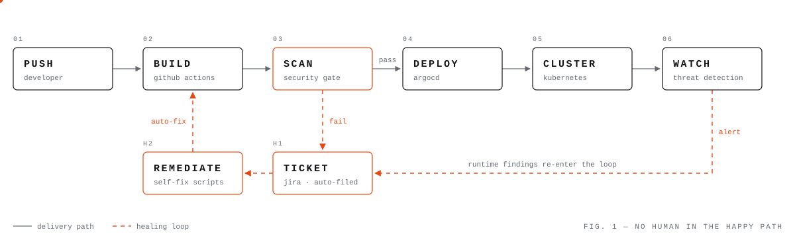
</picture>

Written up in two parts → <a href="https://medium.com/developersglobal/from-chaos-to-clarity-how-we-built-a-self-healing-ci-cd-pipeline-that-talks-to-jira-part-1-b7ee88df0e27">Part 1</a> · <a href="https://medium.com/developersglobal/from-chaos-to-clarity-how-we-built-a-self-healing-ci-cd-pipeline-that-talks-to-jira-part-2-28b59058d90d">Part 2</a>

  

<picture>
  <source media="(prefers-color-scheme: dark)" srcset="./assets/h-work-dark.svg">
  
</picture>

<a href="https://github.com/cyberRuptor/redis-sentinel-helm-chart"><picture><source media="(prefers-color-scheme: dark)" srcset="./assets/card-redis-sentinel-dark.svg">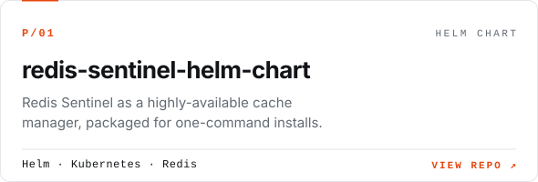</picture></a>
<a href="https://github.com/cyberRuptor/mongodb-helm-chart"><picture><source media="(prefers-color-scheme: dark)" srcset="./assets/card-mongodb-dark.svg">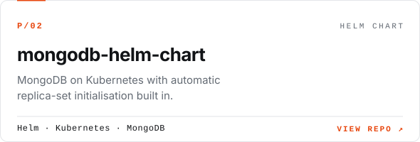</picture></a>

<a href="https://github.com/cyberRuptor/sharepoint-mcp"><picture><source media="(prefers-color-scheme: dark)" srcset="./assets/card-sharepoint-mcp-dark.svg">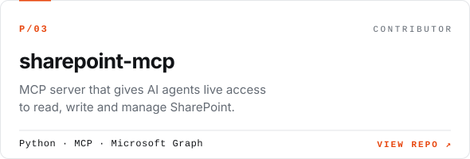</picture></a>
<a href="https://github.com/cyberRuptor/ocft"><picture><source media="(prefers-color-scheme: dark)" srcset="./assets/card-ocft-dark.svg">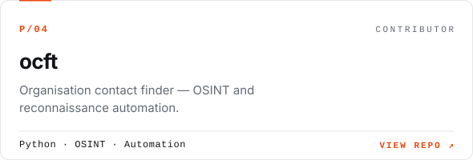</picture></a>

 

<picture>
  <source media="(prefers-color-scheme: dark)" srcset="./assets/h-network-dark.svg">
  
</picture>

<picture>
  <source media="(prefers-color-scheme: dark)" srcset="./assets/live/network-dark.svg">
  
</picture>

 

<picture>
  <source media="(prefers-color-scheme: dark)" srcset="./assets/h-toolkit-dark.svg">
  
</picture>

<picture>
  <source media="(prefers-color-scheme: dark)" srcset="./assets/toolkit-dark.svg">
  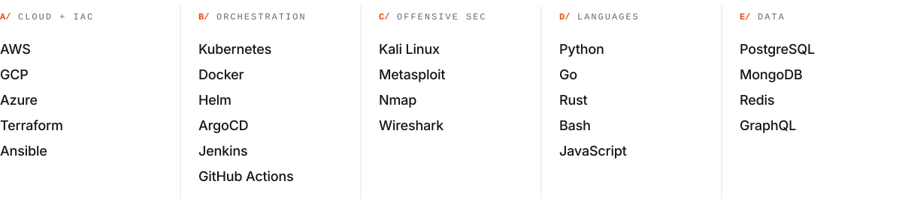
</picture>

  

<picture>
  <source media="(prefers-color-scheme: dark)" srcset="./assets/h-writing-dark.svg">
  
</picture>

<!-- BLOG-POST-LIST:START -->`Jun 2026` &nbsp; [Kubernetes Networking Evolution: Why Gateway API is Replacing Traditional Ingress](https://aws.plainenglish.io/kubernetes-networking-evolution-why-gateway-api-is-replacing-traditional-ingress-01d7765af54e?source=rss-c1c15c424dc9------2) 
`Jun 2026` &nbsp; [kubectl Port-Forward Frontend Loads but API Calls Fail — Fix Explained](https://medium.com/@cyberRuptor/port-forwarding-a-frontend-backend-application-locally-using-an-nginx-gateway-48503c43854f?source=rss-c1c15c424dc9------2) 
`Feb 2026` &nbsp; [From Chaos to Clarity: How We Built a Self-Healing CI/CD Pipeline That Talks to JIRA &lpar;part-2&rpar;](https://medium.com/developersglobal/from-chaos-to-clarity-how-we-built-a-self-healing-ci-cd-pipeline-that-talks-to-jira-part-2-28b59058d90d?source=rss-c1c15c424dc9------2) 
`Feb 2026` &nbsp; [From Chaos to Clarity: How We Built a Self-Healing CI/CD Pipeline That Talks to JIRA &lpar;part-1&rpar;](https://medium.com/developersglobal/from-chaos-to-clarity-how-we-built-a-self-healing-ci-cd-pipeline-that-talks-to-jira-part-1-b7ee88df0e27?source=rss-c1c15c424dc9------2) 
<!-- BLOG-POST-LIST:END -->

 

<picture>
  <source media="(prefers-color-scheme: dark)" srcset="./assets/h-log-dark.svg">
  
</picture>

<picture>
  <source media="(prefers-color-scheme: dark)" srcset="./assets/live/log-dark.svg">
  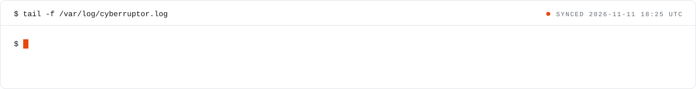
</picture>

 

<picture>
  <source media="(prefers-color-scheme: dark)" srcset="./assets/h-contact-dark.svg">
  
</picture>

<picture>
  <source media="(prefers-color-scheme: dark)" srcset="./assets/contact-dark.svg">
  
</picture>

<a href="mailto:goyalnikhil743@gmail.com"><picture><source media="(prefers-color-scheme: dark)" srcset="./assets/contact-email-dark.svg"></picture></a>
<a href="https://linkedin.com/in/cyberRuptor"><picture><source media="(prefers-color-scheme: dark)" srcset="./assets/contact-linkedin-dark.svg"></picture></a>
<a href="https://cyberruptor.medium.com"><picture><source media="(prefers-color-scheme: dark)" srcset="./assets/contact-medium-dark.svg"></picture></a>

<a href="https://dev.to/cyberruptor"><picture><source media="(prefers-color-scheme: dark)" srcset="./assets/contact-devto-dark.svg"></picture></a>
<a href="https://twitter.com/cyberruptor"><picture><source media="(prefers-color-scheme: dark)" srcset="./assets/contact-x-dark.svg"></picture></a>
<a href="https://app.daily.dev/cyberruptor"><picture><source media="(prefers-color-scheme: dark)" srcset="./assets/contact-dailydev-dark.svg"></picture></a>

 

<picture>
  <source media="(prefers-color-scheme: dark)" srcset="./assets/footer-dark.svg">
  
</picture>
